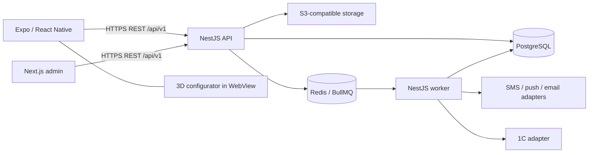

# VEGA: архитектура первого релиза

> Актуализация 26.10.2026: [решения встречи](CUSTOMER-MEETING-2026-10-26.md)
> и [DECISIONS.md](DECISIONS.md) заменяют прежние требования ниже. Отдельная
> админка исключена из целевого релиза; резерв ожидания оплаты и обязательное
> повторное принятие изменений отменены. Цены/наличие — после одобрения менеджером.
> Нижние разделы со старой моделью — история проекта или описание demo,
> не готовый контракт нового процесса. Runtime ещё не адаптирован к новым решениям.


Статус: проектное решение для подготовки разработки. Приложения и инфраструктура
ещё не реализованы. Этот документ не подтверждает работоспособность сборок,
интеграций или деплоя. Требования CI/CD: [CI-CD.md](CI-CD.md).
Порядок работы агентов: [TEAM.md](TEAM.md). Стек, pnpm и версии до bootstrap
являются предложением, которое ещё нужно проверить установкой и сборкой.
Подтверждённые правила: [DECISIONS.md](DECISIONS.md); этапы: [ROADMAP.md](ROADMAP.md);
нормативный API/recovery: [API-CONTRACT.md](API-CONTRACT.md).

## 1. Цель и границы

Одна система обслуживает клиентское приложение Android/iOS и браузерную админку.
Аудитории — автовладельцы и мастера/студии; главная сочетает автомобиль, каталог
и быстрый поиск по артикулу. Актуальный визуальный ориентир — тёмный pushr.
Сервер отвечает за авторизацию, каталог, точные цены, остатки, резервы и заказы.
Клиенты отображают данные и собирают ввод; они не являются источником правил
продажи и не обращаются напрямую к PostgreSQL, Redis или 1С.

Для первого релиза используется модульный монолит NestJS. Разделять его на
микросервисы до появления подтверждённой эксплуатационной необходимости не нужно.
Фоновые обработчики могут запускаться отдельным процессом из того же приложения.

## 2. Компоненты и связи



Браузерная админка и API по возможности публикуются под одним origin с маршрутом
`/api`, чтобы упростить cookie, CORS и защиту сессии. Это не означает размещение
бизнес-логики в Next.js. Мобильное приложение использует публичный HTTPS API.

| Компонент | Ответственность | Не отвечает за |
|---|---|---|
| Mobile | Навигация Expo Router, формы, доступный UI, кэш TanStack Query, secure session storage | Расчёт доверенной цены и разрешение резервов |
| Admin | Таблицы, формы, управление клиентами, товарами, заказами и контентом | Доступ к БД и обход серверных прав |
| API | Проверка ввода и прав, бизнес-операции, транзакции, REST/OpenAPI | Состояние интерфейса и 3D-рендер |
| PostgreSQL | Постоянные данные, ограничения, резервы, outbox, аудит | Временный кэш и файлы |
| Redis / worker | Очереди, ограниченные повторы, доставка событий | Единственный экземпляр критичных данных |
| S3 | Изображения, GLB, обработанные файлы | Персональные данные в публичных URL |
| Configurator | Рендер лицензированных моделей, выбор материала и товара | Определение цены и доступности |

## 3. Структура монорепозитория

```text
apps/
  mobile/                 # Expo, React Native, TypeScript
  admin/                  # Next.js, TypeScript
  api/                    # NestJS API и worker entrypoint
packages/
  contracts/              # Транспортные схемы и ошибки, без Prisma и Nest imports
  api-client/             # Клиент API на основе проверенного OpenAPI
  design-tokens/          # Цвета, отступы, типографика; web/native adapters
  configurator/           # Three.js scene и typed WebView bridge
  tooling/                # Общие lint/TypeScript настройки, если они повторяются
infrastructure/           # Compose, deploy-конфигурация и инструкции
docs/
```

Версии Node.js, pnpm и пакетов закрепляются при инициализации после проверки
совместимости актуального Expo SDK, React Native и native dependencies.
В workspace один lockfile. Выполняется frozen-lockfile установка.

Не переносить React DOM-компоненты в React Native. Общими являются токены,
контракты и чистые функции; компоненты web/native остаются платформенными.
Prisma client и серверные переменные окружения не экспортируются в приложения.

## 4. Модули API

| Модуль | Данные и операции |
|---|---|
| Identity | Телефон/пароль, восстановление, сессии, отзыв доступа, RBAC; SMS позже |
| Customers | Профиль, организации, адреса, закрепление менеджера |
| Catalog | Категории, артикулы, варианты, свойства, длина рулона, цены |
| Media | Разрешённая загрузка, проверка файлов, метаданные |
| Inventory | Склады, полный рулон/отрез, доступность, движения и резервы |
| Cart | Выбранные позиции; цена в корзине не является гарантией |
| Orders | Создание, согласованные версии, снимки позиций, статусы, отмена, идемпотентность |
| Payments | Оплата согласованной версии, webhook/сверка, счета, возвраты |
| Content | Новости и блоки главной |
| Training | Заявки на обучение и ответственные |
| Configurator | Модели, лицензии, материал кузова, связь с товаром |
| Notifications | Пользовательские события, каналы, результат отправки |
| Integrations | 1С, внешние идентификаторы, журналы и сверка |
| Audit | История значимых действий сотрудников и системы |

Модули обращаются через явные сервисные интерфейсы. Production quote и submit
сначала проверяют актуальную доступность 1С. При отсутствии SKU, недостатке,
stale/unavailable Order не создаётся, корзина сохраняется; скрытая «принятая заявка»
не допускается. После успешной проверки локальное сохранение заказа, снимков и
outbox транзакционно. Внешние вызовы не выполняются внутри долгих транзакций.
Сохранённый заказ на согласовании не означает резерв 1С, право оплаты или отправки.

## 5. Контракт API и сессии

- REST API имеет версионируемый префикс `/api/v1` и OpenAPI-описание.
- На транспортной границе используются согласованные DTO/Zod-схемы; ошибки
  имеют стабильный код, безопасное сообщение, field errors и request ID.
- Деньги передаются как целые минимальные единицы строкой с валютой:
  `{amountMinor: "125000", currency: "RUB"}`. Длины — целые миллиметры строкой,
  например `{lengthMm: "5000"}`; дробные метры в DTO не передаются. Валюта примера
  не утверждает production-валюту. Binary floating point для расчётов запрещён.
- Все даты передаются с timezone в ISO 8601, сервер хранит время в UTC.
- Для списков заданы ограничения размера и детерминированная пагинация.
- Авторизация проверяется для каждой операции и каждого объекта. Назначенный
  менеджер не получает доступ к чужим заказам через подстановку ID.
- Мобильная refresh-сессия хранится в SecureStore; access token краткоживущий.
  Браузерная сессия использует HttpOnly/Secure cookie с защитой CSRF.
- Первый вход — телефон/пароль, с защитой от перебора и безопасным восстановлением
  до рабочих аккаунтов. Хэширование паролей выполняется сервером. SMS/OTP позже,
  не prerequisite bootstrap; production не допускает тестовых обходов входа.
- Гостевые DTO и общий кэш не содержат цен/остатков; коммерческие ответы доступны
  после входа и не смешиваются с публичным кэшем. Скрытие только в UI недостаточно.
- Строки корзины адресуются по lineId; unique(cartId, skuId, unit), то есть метры
  и рулоны одного SKU — разные строки. Количество вложенное: `quantity:
  {lengthMm: "5000"}` для meter либо `quantity: {count: 1}` для roll/piece.
  Общий физический остаток проверяется для всех строк совместно.
- Сотрудник изменяет заказ с `expectedOrderVersion`; acceptance использует
  точные `orderVersion`/`deliveryVersion`, payment attempt также `paymentTermsVersion`.
  Поля и версии не подменяются по догадке клиента; нормативные DTO — API-CONTRACT.md.
- Recovery: persistent Idempotency-Key + исходный payload до первого запроса;
  повтор того же POST после timeout/restart. REQUEST_IN_PROGRESS → Retry-After
  и тот же POST; изменённое тело с тем же ключом → 409 IDEMPOTENCY_CONFLICT.
  Lookup endpoint не предполагается; retention — по API-CONTRACT.md.
- Изменения контракта сохраняют совместимость с уже выпущенными mobile builds.

## 6. Остатки и оформление

Длина полного рулона задаётся на уровне продаваемого артикула/варианта. Если у
одного артикула есть разные реальные длины, требуется учёт отдельных рулонов
или складских единиц; среднее значение не заменяет такой учёт.

Сервер различает физический остаток, локальный резерв и доступный к заказу
остаток. Полные рулоны и отрезы нельзя сводить к одному числу метров: это
потеряет возможность выполнить правило запрета нарезки при двух рулонах.
Точная модель согласуется с представлением данных 1С. При двух полных рулонах
и меньше новая нарезка из целых запрещена, но готовые отрезы можно продавать
при достаточной длине; их нельзя вычислять только из общего метража.

При оформлении:

1. Проверить сессию и recovery исходного POST/key/payload. Сохранённый успешный
   результат возвращается до новой бизнес-валидации: истёкший quote его не отменяет.
2. Для новой операции проверить пользователя, адрес, единицы, шаг, минимум и
   актуальную 1С на quote и submit. Нет SKU/недостаток → STOCK_UNAVAILABLE;
   stale/unavailable → INVENTORY_CONFIRMATION_UNAVAILABLE. Order не создавать,
   корзину сохранить. Техническая запись операции не является заказом.
3. Для локальной части в транзакции блокировать нужные строки в стабильном порядке
   либо выполнить эквивалентное условное обновление с контролем конфликтов.
4. Повторно вычислить цену и доступность, применить правило порога нарезки.
5. При изменении цены/состава вернуть клиенту явный конфликт для подтверждения.
6. После успешных проверок создать заказ со снимками и назначением менеджера.
   Доступность при submit не является резервом; локальный резерв демо-режима
   не считать общим резервом рабочего склада.
7. Сохранить outbox-события в той же транзакции и подтвердить результат.
8. Worker отправляет уведомления и обмен с 1С с идемпотентными повторами.
9. Менеджер согласует окончательные состав, цену и доставку; клиент принимает
   версию с expectedOrderVersion/версией доставки по API-CONTRACT.md. Перед
   оплатой снова необходимы актуальная доступность и подтверждённый
   резерв 1С. Изменение условий требует нового согласования.
10. Сервер доверенно подтверждает 100% предоплату картой либо по счёту; только
    затем разрешает отправку. Redirect/скриншот не подтверждают поступление денег.

Повторное оформление не создаёт второй заказ. Отмена освобождает резерв один
раз. Ошибка SMS/push не отменяет сохранённый заказ. Redis не является источником
истины о резерве. Ошибки worker видны сотруднику и допускают повторную обработку.

## 7. Источники данных и 1С

До интеграции допускается только демонстрационный каталог с локальными остатками,
явно обозначенными как тестовые. Такой режим не гарантирует наличие для продаж
через другие каналы заказчика.

Целевой вариант после обследования: 1С владеет согласованными ценами,
номенклатурой и складским учётом; VEGA — описаниями, медиа и контентом.
Заказы возникают в VEGA и передаются в 1С. Доступные количества нельзя
слепо перезаписывать снимком из 1С, если локальные резервы ещё не подтверждены
на её стороне. Нужны correlation ID и правила сверки/подтверждения резервов.

Для каждого импортированного объекта хранить внешний ID, источник и состояние
синхронизации. Сохранять время успешного обмена и журнал ошибок. При устаревших
или недоступных данных, отсутствующем SKU либо недостатке quote/submit завершаются
отказом без Order, корзина сохраняется. Перед оплатой выполняются повторная
проверка и резервирование. Интеграция и резервирование 1С обязательны до production
продаж. Чтение снимка остатков без общего резерва не устраняет гонку каналов.
Поздняя оплата после истечения резерва требует сверки и согласованного возврата/
восстановления; оплаченный заказ не переводится в отправку при отсутствии товара.

## 8. Первый работающий сценарий

| Шаг | Результат | Необходимая проверка |
|---|---|---|
| 1. Foundation | Workspace, Compose PostgreSQL, API health, CI | Чистая установка, миграции и настоящие smoke checks |
| 2. Catalog | Администратор создаёт артикул с длиной рулона и фото | Гость видит товар без цен/остатков; после входа доступны разрешённые поля |
| 3. Inventory | Тестовый склад, рулоны, отрезы, порог | При ≤2 полных нарезка запрещена, готовые отрезы доступны |
| 4. Customer | Телефон/пароль в staging, профиль, роли, менеджеры | Чужие данные недоступны |
| 5. Checkout | Корзина, оформление, резерв, номер заказа | Конкуренция за последний остаток и идемпотентность |
| 6. Fulfilment | Менеджер видит заказ, подтверждает либо отменяет | История и корректное освобождение резерва |
| 7. Staging | Один полный сценарий на тестовой инфраструктуре | Повторяемый deploy и функциональная проверка |

Этот срез предшествует массовому наполнению, push, новостям и полноценному 3D.
Он использует только тестовые товары, клиентов и остатки и не подтверждает
наличие на реальном складе без согласованной интеграции с 1С.
Технический прототип 3D и обследование 1С выполняются заранее параллельно,
чтобы не обнаружить блокирующую несовместимость после реализации каталога.

## 9. Принятые проектные решения

1. Один монорепозиторий и модульный API вместо отдельных микросервисов.
2. Expo mobile, Next.js admin, NestJS, PostgreSQL/Prisma — базовый предложенный стек.
3. Все доверенные правила цены, прав и остатков — на сервере.
4. Публикация заказа и outbox — в одной транзакции.
5. Длина рулона задаётся у товара, отдельные рулоны учитываются при необходимости.
6. 3D изолируется в компонент с typed bridge; окончательный runtime подтверждает
   прототип на реальных устройствах, а не предположение о WebView совместимости.
7. Первый локальный срез демонстрационный; обязательный рабочий релиз включает
   1С и онлайн-оплату после согласования менеджером, с 100% предоплатой до отправки.
   API перевозчиков не обещаны; доставку согласует менеджер.
8. Сборки и production выпускаются по [плану CI/CD](CI-CD.md), с совместимостью
   API и миграций для ранее установленных мобильных приложений.

## 10. Открытые вопросы и зависимости

| Вопрос | Что блокирует | Что можно делать независимо |
|---|---|---|
| Версия и протокол 1С, формат остатков и резервов | Реальный обмен и гарантированное наличие | API, UI и локальный тестовый склад |
| Шаг нарезки, минимум, склады, типы цен и НДС | Production расчёты | Точные типы значений и валидация конфигурации |
| Безопасное восстановление телефона/пароля | Допуск рабочих аккаунтов | Реализация входа, защита от перебора; SMS позже |
| Эквайринг, merchant account, фискализация | Production-оплата | Sandbox-адаптер и согласованные серверные состояния |
| Лицензии и доступные модели/шрифты | Рабочие ассеты и финальный дизайн | Токены, макеты, технический 3D-прототип |
| Хостинг, регион ПДн, домены, мониторинг | Production deploy и legal readiness | Локальная инфраструктура и CI |
| Apple/Google/Expo аккаунты | Подписанные сборки и store release | JS-проверки и доступная Android разработка |
| Протокол общего резерва, сроки оплаты, отмена и детали стоимости доставки | Production checkout и fulfilment | Явно демонстрационный заказ и тесты состояний |

Неизвестные параметры не заменять скрытыми production значениями. До их
согласования демонстрационный режим должен быть отделён от реальных продаж.
