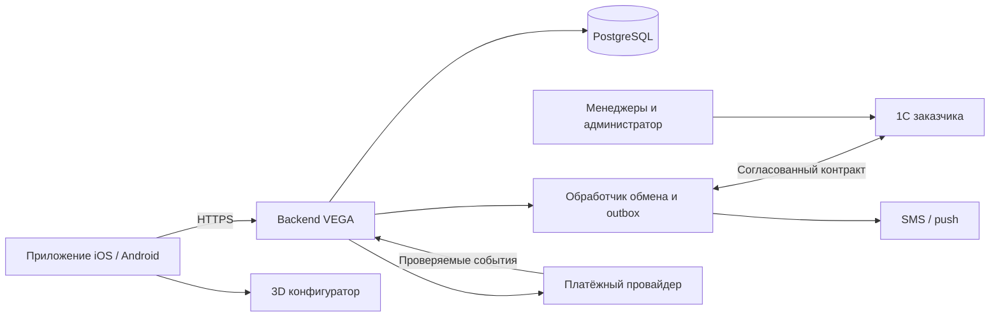

# VEGA: архитектура после решений заказчика

Актуально на 26 октября 2026. Требования: [DECISIONS.md](DECISIONS.md),
зависимости: [решения встречи](CUSTOMER-MEETING-2026-10-26.md).
Документ описывает направление разработки, а не готовую production-систему.
Текущий код и результаты проверок — HANDOFF.md.

## Компоненты и ответственность

Целевой продукт — клиентское приложение iOS/Android. Сотрудники работают в 1С;
отдельная браузерная админка VEGA исключена. Реализованный desktop demo
сохраняется как технический стенд, его наличие не меняет новое решение.

Backend нужен и без админки: сессии/ACL, публичная и закрытая проекции данных,
версионированный обмен, идемпотентность, платёжная сверка и уведомления. Mobile
не получает секреты 1С и не ходит напрямую в её базу. Менеджерские действия,
одобрение/назначение клиентов, счета и отправления проходят согласованный процесс
1С. Объём доработок этой конфигурации определяем с её программистом.

## Реализовано и запланировано

| Область | Состояние |
|---|---|
| NestJS / TypeScript, PostgreSQL / Prisma | Demo API, миграции, readiness и тесты существуют |
| Публичный каталог и фото | Изолированный demo, без цен/наличия в публичной проекции |
| Телефон + пароль | Demo-сессии, защита KDF/rate limits; не SMS-подтверждение |
| Next web | Клиентская демонстрация и сохранённый staff-стенд, не native-приложение |
| Одобрение клиента | Модель и DTO содержат статус (pending, approved, rejected, revoked); реальный сигнал из 1С ещё не подключён |
| 1С, корзина, заказ, эквайринг, доставка, SMS/push | Не реализованы сквозным рабочим процессом |
| Native iOS/Android и 3D | Техническая основа/концепция не заменяют приёмку на устройствах |

Модульный монолит остаётся достаточной основой. Отдельный worker при необходимости
использует тот же код и PostgreSQL/outbox; Redis/BullMQ и S3 не считаются уже
установленными рабочими зависимостями только по диаграмме. Транспорт 1С выбирается
после обследования, не предполагается готовый HTTP/OData сервис.

## Источники истины

- 1С: товары, цены, отрезы/рулоны, контрагенты, менеджеры и права сотрудников,
  заказы, счета, отгрузки/трек. Как передавать одобрение и отзыв клиента, ещё согласуем.
- VEGA: сессии приложения, безопасная проекция каталога, состояние доставки
  сообщений, корреляция и аудит интеграционных операций.
- Платёжный провайдер/согласованный банковский или 1С источник: финансовый факт.
  Клиентский redirect, скриншот или необоснованный ручной статус его не заменяют.

Не создавать вторую независимую систему редактирования цен/остатков в VEGA.
Локальная копия ускоряет чтение, но не гарантирует наличие к оплате.

## Доступ и продажи

Регистрация не открывает коммерческие данные. Гость и ожидающий одобрения
получают одну публичную проекцию; только одобренный клиент видит цены/наличие.
Права проверяются сервером по актуальному состоянию. Роль сотрудника не назначается
из формы покупателя. Покупатель менеджера не выбирает: свободного клиента забирает
менеджер, конкурентное закрепление должно иметь одного победителя.

Color/Color Ultima: при суммарном остатке ≤2 целых рулонов данного SKU запрещены
все отрезы, включая готовые. Плитки 1–18 м не подменяют фактический учёт метражей.
Целый рулон разрешён при положительном достаточном наличии. Ширина, партии,
участвующие склады, цены/НДС/округление ещё обследуются.

Резерв ожидания оплаты исключён; скрытый резерв в VEGA не вводится. Перед
оформлением и оплатой требуется проверка 1С, но она не устраняет гонку с другими
каналами до списания денег. Процесс дефицита и компенсаций остаётся открытым.
Менеджер может менять заказ, но полный процесс финансовых изменений ещё не
утверждён; прежний обязательный повторный acceptance не реализовывать.

## Надёжность обмена

Исходящие операции сохраняются с устойчивыми внешними ID и безопасно повторяются.
Потеря ответа требует сверки исхода, а не слепого создания нового заказа/платежа.
Входящие данные проверяются, версионируются и применяются атомарно; ошибочный
или частичный снимок не удаляет отсутствующие в нём позиции. Старые события
не перезаписывают новые. Долгая внешняя сеть не удерживает SQL-транзакцию.

При сбое предлагается сохранить просмотр последнего снимка с понятной меткой
актуальности и запретить оформление/оплату. Порог свежести и условия восстановления
ещё согласуются. Проверять их нужно на тестовой 1С, не только fake adapter.

## Хранение, выпуск и границы

Demo-фото сейчас нормализуются Sharp в WebP и хранятся в PostgreSQL с лимитами;
для production источник фото из 1С/контента и способ доставки ещё обследуются.
Объектное хранилище/CDN потребуют отдельной миграции и проверки доступа, удаления,
кэша и резервного копирования; не выдавать demo bytes за готовую медиа-платформу.

CI проверяет исходники, тесты, сборки и audit. Деплой и native-релиз — отдельные
этапы после допуска и реальных проверок; web export не является native build.
Срок первого полного релиза уточняется после обследования 1С и первого тестового
заказа. Отдельная админка исключена, но 3D и прочий согласованный объём не исключены.
